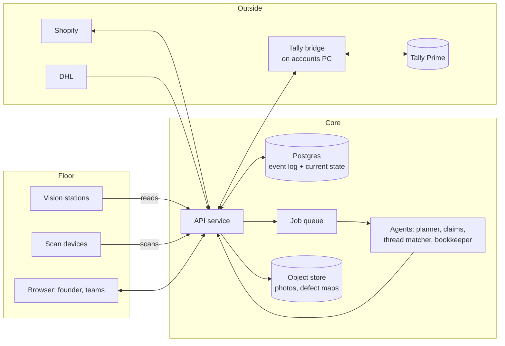

# Architecture

How the Dema Intelligence Room is put together today, and how it becomes a
production system. The front end in this folder is the first half. This document
describes the second half: the record behind it.

Contents:

1. [The ontology](#1-the-ontology)
2. [The event model](#2-the-event-model)
3. [Production architecture](#3-production-architecture)
4. [The scheduling engine](#4-the-scheduling-engine)
5. [Data the ERP needs at go-live](#5-data-the-erp-needs-at-go-live)
6. [Roles and access](#6-roles-and-access)
7. [Open questions for Dema](#7-open-questions-for-dema)

---

## 1. The ontology

The business is described as things, and the relations between them. The 3D map
shows the places (`js/ontology.js`). The ERP holds the things that move through
those places. Both use the same names.

### Entities

| Entity | What it is | Identified by | Key fields |
|---|---|---|---|
| **Supplier** | A fabric mill, a trim vendor or the dye house | Name as in Tally | kind, ledger name, reject rate, open claims |
| **Roll** | One roll of fabric. The unit of fabric stock | QR tag printed at the dock | fabric, supplier, metres, status, 4-point score, defect map, shade, location, reserved-for order |
| **DyeLot** | A set of passed rolls sent to the dye house together | Lot number on the dye challan | fabric, shade, rolls, sent date, due date, returned metres, accepted metres, shade result |
| **Style** | A garment design | Style code | fabric, shade, metres per piece, standard minutes per stage, thread cones per 100 pieces, prices |
| **Order** | A commitment to make pieces of one style | Order number | channel (B2B, D2C, store, sample), customer, style, quantity, due date, pieces done per stage |
| **Bundle** | A stack of cut pieces that travels together | Bundle tag printed at cutting | order, style, size, pieces, current stage, scan history |
| **WorkCentre** | A pool of capacity: cutting, a stitching line, sampling, finishing, QC, packing | Code | people, shift minutes, efficiency, map node |
| **Station** | One workplace inside a work centre | Station code, for example `B2B-07` | work centre, machine, kit list, status |
| **Parcel** | Anything that passes the dispatch gate: a Shopify parcel, an export carton, a store piece | Barcode read at the gate | kind, order reference, barcode, status, events, visit count |
| **Voucher** | One accounting entry, in Tally's vocabulary | Voucher number | date, type, party, debit ledger, credit ledger, amount, narration, source reference, sync status |
| **ThreadShade** | Thread stock for one shade | Shade code | cones on hand, minimum level |
| **Tool** | A consumable or tool with a minimum level | Item code | on hand, minimum, location |

Roll status is the most important field in the system. It moves one way:

```
unaudited ─▶ passed ─▶ at_dyer ─▶ dyed ─▶ issued
     │                     │
     ▼                     ▼
  rejected            dye_reject
(returned, claim)   (written off)
```

A roll can only reach `at_dyer` from `passed`. That one rule is what stops
faulty fabric being dyed. `rejected` is recoverable, because the mill has to take
back undyed fabric. `dye_reject` is a loss. The production head estimates that
loss at north of $250,000 a year today.

### Relations

```mermaid
erDiagram
    SUPPLIER ||--o{ ROLL : supplies
    SUPPLIER ||--o{ DYELOT : dyes
    SUPPLIER ||--o{ VOUCHER : "is party to"
    ROLL }o--o| DYELOT : "dyed in"
    ROLL }o--o| ORDER : "reserved for"
    STYLE ||--o{ ORDER : "made as"
    STYLE }o--|| THREADSHADE : "stitched with"
    ORDER ||--o{ BUNDLE : "cut into"
    ROLL ||--o{ BUNDLE : "cut from"
    WORKCENTRE ||--o{ STATION : contains
    BUNDLE }o--o| STATION : "worked at"
    ORDER ||--o{ PARCEL : "ships as"
    DYELOT }o--o{ ORDER : covers
    ROLL ||--o{ VOUCHER : causes
    DYELOT ||--o{ VOUCHER : causes
    PARCEL ||--o{ VOUCHER : causes
    TOOL }o--o| STATION : "kitted to"

    ROLL {
        string id PK
        string fabric
        int metres
        string status
        int points
        string shade
        string location
    }
    DYELOT {
        string id PK
        string shade
        date sent
        date due
        string status
    }
    ORDER {
        string id PK
        string channel
        string style FK
        int qty
        date due
    }
    BUNDLE {
        string id PK
        string order FK
        int pieces
        string stage
    }
    PARCEL {
        string id PK
        string barcode
        string kind
        string status
        int visits
    }
    VOUCHER {
        string id PK
        date date
        string type
        string dr
        string cr
        decimal amount
        string ref
        bool synced
    }
```

Read as sentences:

- A supplier supplies rolls. The dye house is a supplier that dyes lots.
- A roll is dyed in at most one dye lot, and is reserved for at most one order.
- An order is for one style, is cut into bundles, and ships as one or more parcels.
- A bundle is cut from a roll and worked at stations, one stage at a time.
- A style is stitched with one thread shade. A dye lot covers the orders that
  need its shade, which is how the thread order is raised early.
- A roll, a dye lot or a parcel can cause a voucher. Every voucher points back
  at the thing that caused it.

The map adds one more kind of thing, the **place** (dock, inspection rig, lines,
gate, channels). Places are where events happen. Each entity's `location` or
`stage` is a place on the map, which is how the map can show live state.

---

## 2. The event model

Nothing in the ERP is edited directly. Something physical happens, a person or a
camera records it as an event, and the event changes state and, where money is
involved, raises a voucher.

```
physical event  ─▶  event record  ─▶  state change  ─▶  voucher (if money moved)
   (a scan,           (who, what,       (roll status,      (queued for Tally)
    a camera read,     when, where,      stock, order
    an entry)          evidence)         progress)
```

| # | Event | Recorded by | State change | Voucher |
|---|---|---|---|---|
| 1 | Fabric received at dock | Storekeeper, against the PO | Rolls created as `unaudited`, QR tags printed | Purchase: debit Fabric Purchases, credit the mill |
| 2 | Roll inspected: pass | Checker, with the rig's defect map | Roll `passed`, score stored | None. The purchase was booked at receipt |
| 3 | Roll inspected: fail | Checker, with photos | Roll `rejected`, moved to returns bay | Debit Note: debit the mill, credit Purchase Returns |
| 4 | Dye lot sent | Storekeeper, on the dye challan | Rolls `at_dyer`, lot opened. Thread requirement raised for the shade | None |
| 5 | Dye lot returned: accepted | Checker at the light box | Rolls `dyed`, racked, reserved for orders | Purchase: debit Dyeing Charges, credit the dyer, for accepted metres |
| 6 | Dye lot returned: fabric fault found after dyeing | Checker | Roll `dye_reject`, moved to write-off bay | Journal: debit Fabric Loss: Post-Dye Defects, credit Stock: Dyed Fabric |
| 7 | Roll issued to cutting | Scan at the store | Roll `issued`, order's fabric drawn down | None |
| 8 | Bundle created | Cutting, tag printed | Bundle at stage `cut`, order progress updated | None |
| 9 | Bundle scanned into a stage | Tailor or supervisor | Bundle stage and station set, timer starts | None |
| 10 | Bundle scanned out of a stage | Tailor or supervisor | Minutes per piece stored, order progress updated | None. Piece rates can be derived later |
| 11 | Piece fails final QC | Checker | Rework logged against style, operation and station | None |
| 12 | Parcel scanned out | Gate camera | Parcel `in_transit`, order shipped, stock down | Sales: B2B to the customer's ledger, Shopify to a clearing ledger |
| 13 | Carrier update | DHL connector | Event appended to the parcel | None |
| 14 | Customer return scanned in | Gate camera, reason picked | Parcel `returned`, stock up, pending inspection | Credit Note once the refund is approved |
| 15 | Store piece scanned in for fit | Gate camera, fit note entered | Visit count up, alteration job queued | None |
| 16 | Store piece scanned out | Gate camera | Time in factory and work minutes stored on the piece's note | None |
| 17 | Thread or tool count changed | Camera read or stock entry | Stock updated. Purchase request raised under the minimum | Purchase when the goods arrive |
| 18 | Payment made or received | Accounts, in Tally | Voucher pulled back and matched to its invoice | Payment or Receipt, entered in Tally |

Three rules hold the model together:

1. **Events are never changed.** A mistake is corrected by a new event that
   reverses the old one. The history stays whole.
2. **Every event carries evidence.** Who or what recorded it, when, where, and a
   photo or scan where one exists.
3. **Every voucher names its source.** The accountant can open any voucher and
   see the roll, lot or parcel behind it.

Event 1 books the purchase at the goods receipt, and a failed roll (event 3)
reverses its share with a debit note, so the claim on the mill is visible in the
books. This is what `erp.js` does today. Whether Dema's accountant would rather
book only when a roll passes is an open question (section 7).

---

## 3. Production architecture

The demo keeps state in the browser. The production system keeps the same
front end and puts a real record behind it.



### Pieces

- **Postgres** is the single record. Two kinds of table:
  - `event`: append-only. One row per physical event with type, actor, device,
    time, place, payload and a link to evidence. This is the source of truth.
  - Current-state tables (`roll`, `dye_lot`, `orders`, `bundle`, `parcel`,
    `voucher`, `thread_shade`, `tool`): what the views read. Each is updated in
    the same transaction as the event that changed it, and can be rebuilt from
    the event log.
- **API service.** One service that validates each event, applies the rules
  (a roll cannot go to the dyer without a pass), writes the event and the state
  change together, and serves the views. The front end's `store.js` is replaced
  by calls to it. Live updates reach open browsers over server-sent events or a
  websocket.
- **Object store** for photos and defect maps. Rows hold links, not images.
- **Job queue** for anything slow or outside the request: agent runs, connector
  calls, schedule recomputes. Jobs are retried and idempotent.
- **Agents** are queue workers. Each reads from the API, prepares its output
  (a schedule, a claim draft, a purchase request, a voucher) and writes it back
  as a proposal with a status. A person approves anything marked as needing
  approval. An agent has no path to the database except through the API.
- **Vision stations** run their model on a small PC beside the camera and post
  results to the API as events. If the network drops they queue locally and send
  later. The floor keeps working.
- **Scan devices** are phones or handhelds showing a scan-only screen.
- **Connectors.** Shopify by Admin API and webhooks. DHL by tracking API. Tally
  through a bridge on the accounts PC, described in `TALLY-CONNECTOR.md`.

### Audit trail

Every state row carries `updated_by_event`. The event log gives the full history
of any roll, bundle, parcel or voucher: who did what, when, with what evidence.
Nothing is deleted. Access to money-related tables is logged as well.

### Hosting

A single small cloud deployment in an Indian region is enough at Dema's scale:
one API instance, one managed Postgres, one worker. The factory needs reliable
Wi-Fi at the dock, the rig, the lines and the gate. The site visit sizes that.

---

## 4. The scheduling engine

`js/engine.js` is the reference implementation. The map, the Production room
and the planner agent all read the one schedule it produces.

**What it is.** A finite-capacity, forward scheduler over daily buckets.

- Each **work centre** has standard minutes per day:
  people × shift minutes × efficiency.
- Each **order** needs minutes at five stages: cut, stitch, finish, QC, pack.
  Minutes per piece come from the style. Samples take a multiple of that.
- Stitching has three pools: the B2B line, the D2C line and the sampling room.
  An order's channel decides its pool. A sample run can be allowed to borrow a
  line.
- The calendar is Monday to Saturday.

**How it runs.** For each working day, orders are taken in priority order
(due date by default) and given capacity from what is left in each work centre.
A piece can only enter a stage the day after it left the one before. An order
cannot start before its fabric is ready. The run ends with a finish date for
every order and the load on every work centre for every day.

**What-if.** A scenario is a set of changes laid over the real state: extra
runs, a demand uplift, absent tailors, a late fabric lot, overtime, added
people, outside job-work, a different priority rule. The engine runs once
without the scenario and once with it, and reports the difference: which orders
move and by how many days, which work centre goes over, what material is short,
and what the levers cost. It can also search the levers for the cheapest set
that brings the plan back.

**What it does not do yet.** It plans at the level of work centres, not single
machines or tailors. It does not model changeover time between styles, or
operation-level line balancing. Stage minutes are a single number per style.
These are deliberate simplifications for a first schedule the whole team can
read. Where this section and `engine.js` differ, the file is the definition.

**How it gets better.** Bundle scans replace standard minutes with measured
minutes per style. Absence and machine status come from the floor module. The
schedule then recomputes whenever an event changes its inputs.

---

## 5. Data the ERP needs at go-live

| Data | Source today | Needed for |
|---|---|---|
| Style master: fabric, metres per piece, stitch time, thread | Merchandising and the production head | Scheduling, material checks |
| Open orders, B2B and D2C, with due dates | Revolve portal, buyer emails, Shopify | The order book |
| Work centres: people, shifts, machines | Production head | Capacity |
| Supplier list and open purchase orders | Purchase records, Tally | Receipts, claims |
| Ledger list and stock items as named in Tally | Tally export | Voucher mapping |
| Opening fabric stock, roll by roll | The dark-room audit and a rack count | Inventory |
| Thread stock by shade code, tools and consumables with minimums | A one-time count | Minimum levels |
| Shopify and DHL API access | Shopify admin, DHL account manager | Connectors |
| People and roles | Founder | Access |
| Floor plan with dimensions | Site visit | The map, camera positions |

Stitch times are the item most likely to be missing. A week of timing the
bestsellers by hand is enough to start. Bundle scans take over from there.

---

## 6. Roles and access

| Role | Sees | Can do |
|---|---|---|
| **Founder** | Everything | Everything, including approving write-offs and changing roles |
| **Production head** | Map, Production room, all ERP modules | Approve schedule changes, move work between lines, approve rejections and purchase requests |
| **Merchandising** | Map, Production room, order book | Run what-if scenarios, request sample runs. Cannot commit a change to the schedule |
| **Store (Bombay)** | Their orders and pieces, with fit history | Raise store orders and fit visits |
| **Accounts** | Finance module, vouchers and their sources, supplier claims | Approve unusual vouchers, run the Tally sync, reconcile |
| **Floor supervisor** | Their work centre's queue and stock | Record scans, receipts, counts, rework, absences |
| **Floor device** | A scan screen | Scan in, scan out. Nothing else |

Notes:

- Floor devices are scan-only. They are signed in as a station, show the bundle
  just scanned and nothing more, and cannot browse orders, prices or people.
- Cost, price and ledger figures are visible to the founder, the production
  head and accounts only.
- Time-per-piece data is reported by style and by line. Reports by individual
  tailor are available to the production head, for coaching and line balancing.
  Who else may see them is a decision for Dema (section 7).
- Every sign-in is a named person or a named device. There are no shared logins.

---

## 7. Open questions for Dema

1. **Purchase booking.** Book the fabric purchase on receipt with a debit note on
   rejection (as built), or only when a roll passes inspection? This is the accountant's call.
2. **Rejection threshold.** What 4-point score fails a roll, by fabric? Is there
   a middle band that is accepted at a discount?
3. **Mill terms.** Do current purchase terms give Dema the right to return on
   inspection, and within how many days of delivery?
4. **Dye house terms.** Is the dyer paid on metres sent or metres accepted?
   Who bears a shade failure?
5. **B2B and D2C lines.** Are they fully separate people and machines, or do
   tailors move between them today? The schedule needs to match reality.
6. **Shifts and overtime.** Actual shift length, breaks, weekly day off, and
   what overtime is allowed and at what rate.
7. **Piece rates.** Are tailors paid by time, by piece, or both? This decides
   whether scan data feeds wages.
8. **Per-tailor data.** Who may see time per piece by individual tailor, and how
   it is used.
9. **Store fit visits.** Is alteration work charged to the store, the customer
   or absorbed?
10. **Shopify stock.** Is Shopify selling from finished stock, made to order, or
    both? This decides which direction stock sync runs.
11. **Tally.** Version, single or multi-user, where it runs, and how GST is set
    up. Detail in `TALLY-CONNECTOR.md`.
12. **The loss figure.** The $250,000 a year is an estimate. A first job in
    Phase 1 is to measure it from the write-off bay and past dyer returns, so
    the saving can be tracked against a real baseline.
